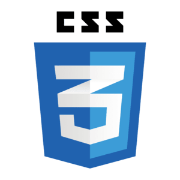

<h1 id="html-and-css">HTML :globe_with_meridians: and CSS :art:</h1>

**Welcome to out first contact with hands on web development!** :tada:

In this guide, we will explore two fundamental building blocks of **Client-side** (**Website**) development - **HTML** and **CSS**. Just like in the last guide we will be relying on the [MDN Web Docs](https://developer.mozilla.org/en-US/docs/Web) as our main resource for learning.

By now you should be familiar with the basic concepts of Web Development. As we have seen in the last guide, **HTML** and **CSS** are two of the three main technologies used in web development. **HTML** is used to structure the content of a webpage, while **CSS** is used to style and layout the content.

Lets get started! :rocket:

<h2 id="table-of-contents">:scroll: Table of Contents</h2>

- [HTML :globe_with_meridians: and CSS :art:](#html-and-css)
  - [:scroll: Table of Contents](#table-of-contents)
  - [:globe_with_meridians: HTML](#html)
    - [:clipboard: Topics](#topics-html)
  - [:art: CSS](#css)
    - [:clipboard: Topics](#topics-css)
  - [:dart: Assignments (HTML + CSS)](#assignments)
    - [:dart: Assignment 1 - Website login page concept](#assignment-1)
    - [:dart: Assignment 2 - Restaurant website concept](#assignment-2)
    - [:dart: ★ Assignment 3 (Bonus) - Custom website concept](#assignment-3)

<h2 id="html">:globe_with_meridians: HTML</h2>

In this section we will be referring to the [Structuring the web with HTML](
<https://developer.mozilla.org/en-US/docs/Learn/HTML>) section of the MDN Web Docs. We will cover the [Introduction to HTML](https://developer.mozilla.org/en-US/docs/Learn/HTML/Introduction_to_HTML) module, but feel free to read the rest of the modules as well.

Lets start by reading the [HTML basics](https://developer.mozilla.org/en-US/docs/Learn/Getting_started_with_the_web/HTML_basics) article. Next read the previously mentioned articles (the ones under the [Introduction to HTML](https://developer.mozilla.org/en-US/docs/Learn/HTML/Introduction_to_HTML) module) with an emphasis on the following [**Topics**](#topics-html).

<h3 id="topics-html">:clipboard: Topics</h3>

- HTML Page Structure
- Tags (these are just the most useful ones, full list can be found [here](https://developer.mozilla.org/en-US/docs/Web/HTML/Element))
  - Head
  - Body
  - Headings
  - Paragraph
  - Hyperlink
  - Button
  - Input
  - Select
  - Form
  - Canvas
  - Div
  - Break
  - Image
  - List
  - Script
  - Style
  - Span
  - Title
  - Metadata
  - Table
  - Comments

★ *Feel free to search the MDN Web Docs or other resources for more information on any of the topics.*

<h2 id="css">:art: CSS</h2>

In this section we will be referring to the [Styling the web with CSS](https://developer.mozilla.org/en-US/docs/Learn/CSS) section of the MDN Web Docs. We will cover the [CSS first steps](https://developer.mozilla.org/en-US/docs/Learn/CSS/First_steps) module, but feel free to read the rest of the models as well.

Lets start by reading the [CSS basics](https://developer.mozilla.org/en-US/docs/Learn/Getting_started_with_the_web/CSS_basics) article. Next read the previously mentioned articles (the ones under the [CSS first steps](https://developer.mozilla.org/en-US/docs/Learn/CSS/First_steps) module) with an emphasis on the following **Topics**.

<h3 id="topics-css">:clipboard: Topics</h3>

- CSS Syntax
- Selectors
  - Types
  - Classes
  - IDs
  - Attributes
  - Pseudo-classes and pseudo-elements
  - Combinators
- Properties (these are just the most useful ones, full list can be found [here](https://developer.mozilla.org/en-US/docs/Web/CSS/Reference))
  - Sizing (width, height, min-width, max-width, min-height, max-height)
  - Position (position, top, bottom, left, right)
  - Background
  - Border
  - Shadow
  - Color
  - Display
  - Font
  - Grid
  - Margin
  - Padding
  - Text
  - Transform
  - Transition
  - Visibility
  - Z-index
- Flexbox layout module (info can be found [here](https://developer.mozilla.org/en-US/docs/Web/CSS/CSS_Flexible_Box_Layout/Basic_Concepts_of_Flexbox))
  - flex-direction
  - flex-wrap
  - flex-basis
  - flex-grow
  - flex-shrink
  - align-items
  - align-content
  - justify-content
  
★ *Feel free to search the MDN Web Docs or other resources for more information on any of the topics.*

★ *A great way I recommend learning flex-box is with the [Flexbox Froggy](https://flexboxfroggy.com/) game.*

<h2 id="assignments">:dart: Assignments (HTML + CSS)</h2>

Generally the process of developing a website goes like this:

1. The **Company** or **Client** comes up with an idea for a website.
2. The **Company** plans and creates a specifications document.
3. **UI/UX** designers design the website using applications like [Adobe Photoshop](https://www.adobe.com/il_en/products/photoshop.html), [Adobe XD](https://helpx.adobe.com/il_en/support/xd.html) or [Figma](https://www.figma.com/).
4. **Web developers** create the frontend using **HTML**, **CSS** and **JavaScript** (or other technologies we will cover later), and create the backend using a **Server-side** language like [Node.js](https://nodejs.org/en/), [PHP](https://www.php.net/), [Java](https://www.java.com/en/), etc...
5. **QA** engineers test the website, make sure it meets the specifications, and as their name suggests, assure the quality of the website.
6. **DevOps** engineers deploy the website on a server or an environment and make it available to the public.
7. The **Company** maintains the website and updates it as needed.
8. Profit :moneybag::moneybag::moneybag:

In this section we will play part of the role of **Web developers**. We will be given images of websites and we will have to write **HTML** and **CSS** code to create matching websites. While creating your websites, make sure they are **responsive**, meaning they look good on all screen sizes.

Since we haven't learned **JavaScript** yet, we will refrain from adding any functionality to the website. Hence the website will be **static**, and will not be able to interact with the user (Adding animations with **CSS** is allowed, but not required. Bonus assignments will be given for those of you who want to challenge themselves).

:information_source: *For easier time developing, you can use the [Live Server](https://marketplace.visualstudio.com/items?itemName=ritwickdey.LiveServer) extension for **VSCode** to view your website in the browser with real time updates!*

<h3 id="assignment-1">:dart: Assignment 1 - Website login page concept</h3>

:information_source: *The images can be found in the [assets](/assets) folder.*

<h3 id="assignment-2">:dart: Assignment 2 - Restaurant website concept</h3>

:information_source: *The images can be found in the [assets](/assets) folder.*

<h3 id="assignment-3">:dart: ★ Assignment 3 (Bonus) - Custom website concept</h3>

Let your imagination run wild! :paintbrush::art::sparkles:

Find a website concept you like and create it using **HTML** and **CSS**. You can search for one on the web, recreate your favorite website, or even come up with your own concept!

Bonus points will be awarded for:

- Responsive design (using **Flex**, **Grid**, **Media queries**, etc...).
- Using **CSS** animations, transitions, and transformations.
- Clean code (using **CSS** variables for colors, sizes, etc...).
- Creativity and complexity of the website.
